# AWS VPC Peering — Private Connectivity Across Two VPCs

  

A hands-on AWS networking project demonstrating **private communication between two non-overlapping VPCs** using VPC Peering. A public bastion host provides controlled SSH administration, while both application instances remain private and have no public IPv4 addresses.

> **Project:** AWS VPC Peering (Project 01) · **Course:** AWS Architect Associate — EWB Courses · **Batch:** AWS Internship Batch 1  
> **Author:** Md Farhan Kalim · **Region:** Asia Pacific (Sydney), `ap-southeast-2` · **Completion date:** 24 October 2026

---

## Contents

- [Architecture](#architecture)
- [Objectives](#objectives)
- [AWS resource inventory](#aws-resource-inventory)
- [Network and routing design](#network-and-routing-design)
- [Security group rules](#security-group-rules)
- [Implementation walkthrough](#implementation-walkthrough)
- [Validation and test results](#validation-and-test-results)
- [Controlled failure and recovery](#controlled-failure-and-recovery)
- [How packet traffic flows](#how-packet-traffic-flows)
- [SSH access through the bastion](#ssh-access-through-the-bastion)
- [Cleanup](#cleanup)
- [Key learnings](#key-learnings)
- [Repository structure](#repository-structure)
- [Security notes](#security-notes)

## Architecture

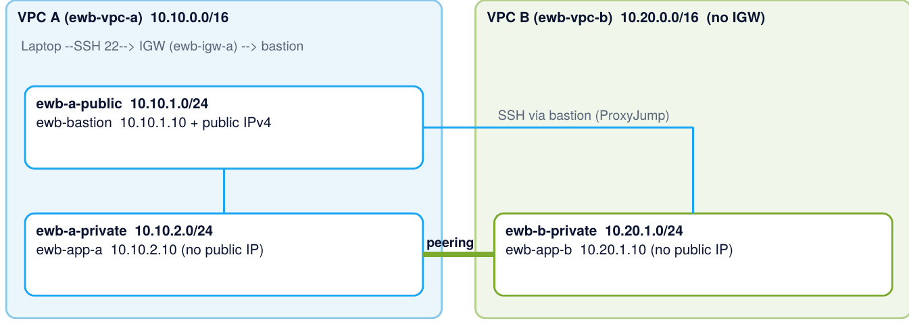

**Architecture at a glance**

- **VPC A:** `10.10.0.0/16` — public bastion subnet and private App-A subnet.
- **VPC B:** `10.20.0.0/16` — private App-B subnet.
- **VPC Peering:** Connects VPC A and VPC B using `ewb-a-b-peer`.
- **Bastion:** The only instance with a public IPv4 address; used as the SSH jump host.
- **App-A and App-B:** Private EC2 instances communicate over private IP addresses through the peering connection.

The CIDR ranges do not overlap. VPC Peering is **not transitive** and does not provide VPC B with internet access through VPC A.

## Objectives

1. Build two separate VPCs with non-overlapping CIDR ranges.
2. Place a bastion host in a public subnet and application instances in private subnets.
3. Establish and activate a VPC Peering connection.
4. Configure forward and return routes on both sides of the peering connection.
5. Restrict SSH and ICMP ingress with source-specific security group rules.
6. Verify private connectivity in both directions.
7. Demonstrate the effect of removing and restoring an inbound ICMP rule.
8. Remove lab resources and check for remaining billable resources.

## AWS resource inventory

| Resource | Name | Resource ID | Network / details |
|---|---|---|---|
| VPC A | `ewb-vpc-a` | `vpc-051367865f2b6da9a` | `10.10.0.0/16` |
| VPC B | `ewb-vpc-b` | `vpc-0f2ddbfbf7884ca8e` | `10.20.0.0/16` |
| Public subnet | `ewb-a-public` | `subnet-0b3d1ae456e52f1aa` | `10.10.1.0/24` |
| Private subnet A | `ewb-a-private` | `subnet-045b7c8d210afe8c7` | `10.10.2.0/24` |
| Private subnet B | `ewb-b-private` | `subnet-04180c4da4c04106a` | `10.20.1.0/24` |
| Internet Gateway | `ewb-igw-a` | `igw-040e25429cb4bd7e3` | Attached to VPC A |
| Public route table | `ewb-rt-a-public` | `rtb-0e206113972fb62ea` | VPC A |
| Private route table A | `ewb-rt-a-private` | `rtb-041ac1d7e934683d6` | VPC A |
| Private route table B | `ewb-rt-b-private` | `rtb-0916f413e69420d39` | VPC B |
| Bastion security group | `ewb-sg-bastion` | `sg-03fa79376f9eb05fa` | VPC A |
| App-A security group | `ewb-sg-app-a` | `sg-017507fec9399f1b3` | VPC A |
| App-B security group | `ewb-sg-app-b` | `sg-02210b6231d86b9fd` | VPC B |
| Bastion EC2 | `ewb-bastion` | `i-0decd5845c6e733cc` | `10.10.1.10` + public IPv4 |
| App-A EC2 | `ewb-app-a` | `i-0de60de664b331bb3` | `10.10.2.10`, no public IP |
| App-B EC2 | `ewb-app-b` | `i-087435a7a9de316dd` | `10.20.1.10`, no public IP |
| VPC Peering | `ewb-a-b-peer` | `pcx-0c0926e9599670d62` | Requester VPC A; accepter VPC B; Active |

> Resource IDs are copied from the project report and are historical lab identifiers. AWS may assign different IDs when the environment is recreated.

## Network and routing design

### Subnets

| Subnet | VPC | CIDR | Route table | Auto-assign public IPv4 |
|---|---|---|---|---|
| `ewb-a-public` | VPC A | `10.10.1.0/24` | `ewb-rt-a-public` | Disabled at subnet; bastion public IPv4 assigned at launch |
| `ewb-a-private` | VPC A | `10.10.2.0/24` | `ewb-rt-a-private` | Disabled |
| `ewb-b-private` | VPC B | `10.20.1.0/24` | `ewb-rt-b-private` | Disabled |

### Final route tables

| Route table | Destination | Target | Purpose |
|---|---|---|---|
| `ewb-rt-a-public` | `10.10.0.0/16` | `local` | VPC A local traffic |
| `ewb-rt-a-public` | `0.0.0.0/0` | `ewb-igw-a` | Bastion internet connectivity |
| `ewb-rt-a-public` | `10.20.0.0/16` | `ewb-a-b-peer` | Bastion to VPC B / App-B |
| `ewb-rt-a-private` | `10.10.0.0/16` | `local` | VPC A internal traffic |
| `ewb-rt-a-private` | `10.20.0.0/16` | `ewb-a-b-peer` | App-A to VPC B |
| `ewb-rt-b-private` | `10.20.0.0/16` | `local` | VPC B internal traffic |
| `ewb-rt-b-private` | `10.10.0.0/16` | `ewb-a-b-peer` | Return traffic to VPC A |

Both VPCs need routes to the peer CIDR. A forward route without a return route is not enough for two-way communication.

## Security group rules

| Security group | Inbound type | Source | Purpose |
|---|---|---|---|
| `ewb-sg-bastion` | SSH / TCP 22 | Your public IPv4 `/32` | Restrict bastion SSH to your laptop |
| `ewb-sg-app-a` | SSH / TCP 22 | `10.10.1.10/32` | SSH to App-A from bastion |
| `ewb-sg-app-a` | ICMP Echo request | `10.20.1.10/32` | Allow ping from App-B |
| `ewb-sg-app-b` | SSH / TCP 22 | `10.10.1.10/32` | SSH to App-B from bastion |
| `ewb-sg-app-b` | ICMP Echo request | `10.10.2.10/32` | Allow ping from App-A |

Outbound rules were left at their default allow-all setting in this lab. No SSH or ICMP inbound rule was opened to `0.0.0.0/0`.

## Implementation walkthrough

The following sequence describes the completed lab. Recreating it requires valid AWS credentials, an EC2 key pair, and appropriate IAM permissions.

1. **Create VPC A and VPC B.** Use `10.10.0.0/16` and `10.20.0.0/16`; ensure the CIDRs do not overlap.
2. **Create the subnets.** In VPC A create `10.10.1.0/24` (public) and `10.10.2.0/24` (private). In VPC B create `10.20.1.0/24` (private).
3. **Configure VPC A internet access.** Attach `ewb-igw-a` to VPC A and add `0.0.0.0/0 → ewb-igw-a` to the public route table.
4. **Create and associate route tables.** Explicitly associate each subnet with the route table listed above.
5. **Launch the EC2 instances.** Launch `ewb-bastion` in the public subnet with a public IPv4 address. Launch `ewb-app-a` and `ewb-app-b` in their private subnets without public IPv4 addresses.
6. **Configure security groups.** Apply the source-restricted SSH and ICMP rules from the table above. Use your own current public IPv4 `/32` for bastion SSH.
7. **Create VPC Peering.** Create `ewb-a-b-peer` with VPC A as requester and VPC B as accepter, then accept the request. Confirm the status is `Active`.
8. **Add peering routes.** Add `10.20.0.0/16 → pcx` to both VPC A route tables and `10.10.0.0/16 → pcx` to VPC B's private route table.
9. **Verify connectivity.** Test the baseline before peering (where captured), then test forward and reverse private-IP connectivity after routes and security groups are in place.
10. **Perform the controlled failure test.** Remove only App-B's inbound ICMP Echo request rule from `10.10.2.10/32`; test the ping failure; restore the exact rule and verify recovery.

### Suggested verification commands

Run on App-A:

```bash
hostname
hostname -I
ping -c 4 10.20.1.10
```

Run on App-B:

```bash
hostname
hostname -I
ping -c 4 10.10.2.10
```

The report records the terminal outputs in the screenshots below. These commands are for verification; the original report does not include a complete AWS CLI provisioning script.

## Validation and test results

| Test | Where / command | Expected or observed result |
|---|---|---|
| Baseline before peering | App-A: `ping -c 4 10.20.1.10` | No replies; 100% packet loss |
| Forward connectivity | App-A: `ping -c 4 10.20.1.10` | 4 replies; 0% packet loss |
| Reverse connectivity | App-B: `ping -c 4 10.10.2.10` | 4 replies; 0% packet loss |
| SSH through bastion | Laptop: `ssh ewb-app-b` | Shell on App-B through bastion / ProxyJump |
| Private-instance isolation | EC2 instance details | App-A and App-B have no public IPv4 addresses |

### Screenshot evidence

**1. EC2 instance inventory**

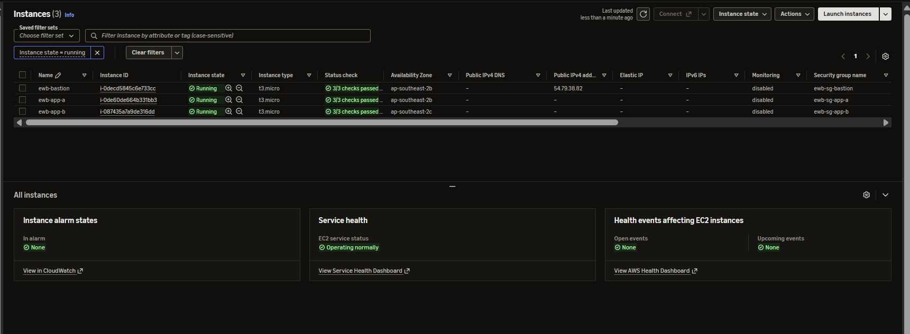

**2. Route table and VPC configuration evidence**

The original report includes console captures for the public and private route tables, their associations, and peering routes.

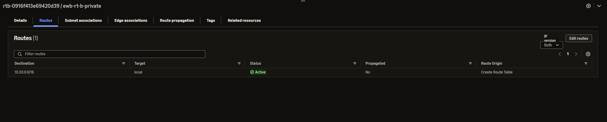

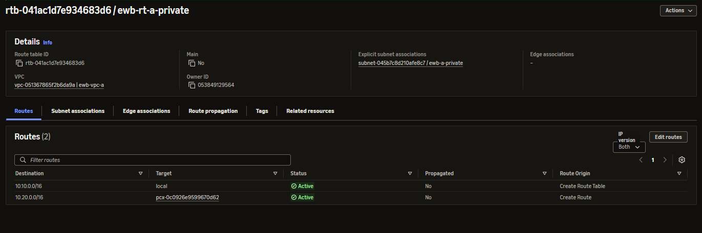

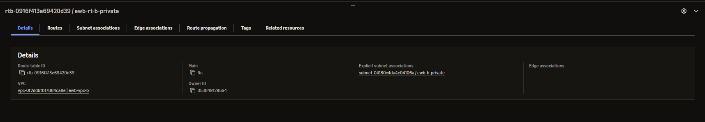

**3. Baseline ping before peering**

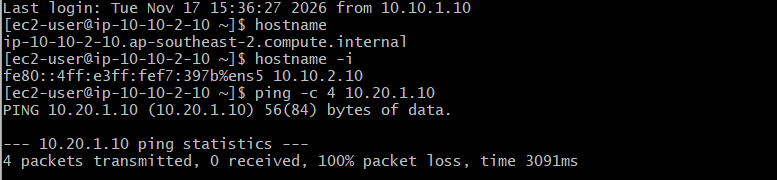

**4. Successful forward and reverse ping**

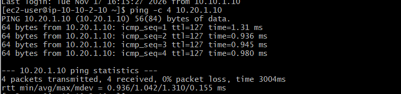

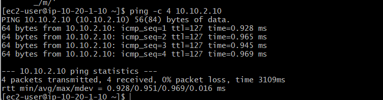

**5. SSH access through bastion**

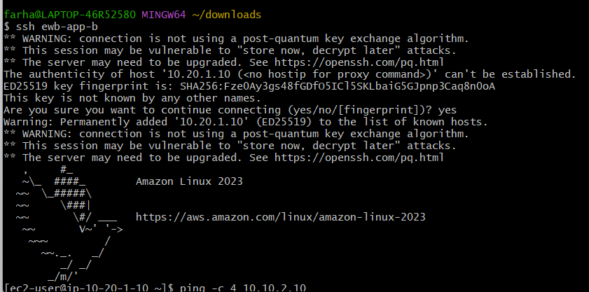

**6. Private EC2 instance evidence**

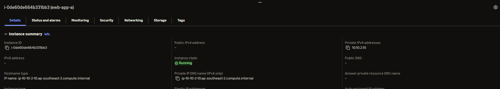

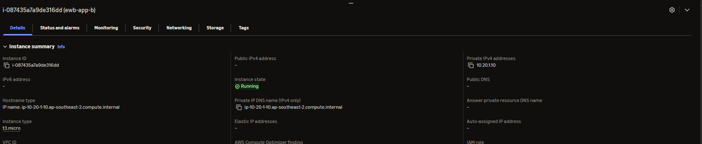

## Controlled failure and recovery

A deliberate security-group failure was introduced without changing the route tables or peering connection:

1. In `ewb-sg-app-b`, remove only the inbound **ICMP Echo request** rule with source `10.10.2.10/32`.
2. From App-A, run `ping -c 4 10.20.1.10`. Replies stop.
3. Restore the same inbound ICMP rule.
4. Repeat the ping. Replies resume (4/4 in the report).

**What this demonstrates:** the peering connection and route tables provide a network path, but they do not override security-group filtering. The destination security group must allow the inbound traffic. The SSH rule remains in place throughout this test.

## How packet traffic flows

### Forward path: App-A to App-B

1. App-A (`10.10.2.10`) sends an ICMP Echo Request to App-B (`10.20.1.10`).
2. `ewb-rt-a-private` matches destination `10.20.0.0/16` and forwards the packet to `ewb-a-b-peer`.
3. The packet reaches VPC B and is delivered to App-B.
4. `ewb-sg-app-b` permits ICMP Echo Request from `10.10.2.10/32`.

### Return path: App-B to App-A

1. App-B sends the Echo Reply to `10.10.2.10`.
2. `ewb-rt-b-private` matches destination `10.10.0.0/16` and routes it through the peering connection.
3. The reply reaches App-A. Security groups are stateful, so response traffic for an allowed connection is automatically permitted.

## SSH access through the bastion

The laptop connects to the bastion first. The bastion then opens a **separate SSH connection** to the private application instance. App-B therefore sees the bastion's private IP (`10.10.1.10`) as the SSH source.

A local SSH configuration can use `ProxyJump`:

```sshconfig
Host ewb-bastion
    HostName <BASTION_PUBLIC_IP>
    User ec2-user
    IdentityFile ~/.ssh/<YOUR_KEY>.pem

Host ewb-app-a
    HostName 10.10.2.10
    User ec2-user
    IdentityFile ~/.ssh/<YOUR_KEY>.pem
    ProxyJump ewb-bastion

Host ewb-app-b
    HostName 10.20.1.10
    User ec2-user
    IdentityFile ~/.ssh/<YOUR_KEY>.pem
    ProxyJump ewb-bastion
```

Connect using the alias:

```bash
ssh ewb-app-a
ssh ewb-app-b
```

Replace the placeholders with your actual bastion public IP and local key filename. Do not commit private keys. The public subnet route table includes `10.20.0.0/16 → ewb-a-b-peer`, allowing the bastion to reach App-B over the private network.

## Cleanup

The report records the following cleanup sequence:

1. Terminate `ewb-bastion`, `ewb-app-a`, and `ewb-app-b`; confirm EBS volumes are deleted; release any Elastic IP; remove the lab key pair.
2. Delete peering routes, then the peering connection, security groups, subnets, and custom route tables. Detach and delete the Internet Gateway, then delete both VPCs.
3. Filter resources by `Project = EWB-VPC-Peering` and verify that no lab EC2 instances, volumes, public IPv4 allocations, or VPC resources remain.

> Always verify that a resource belongs to your lab before deleting it. The project report states that cleanup was completed and the remaining resource checks were clear.

## Key learnings

- VPC Peering connects two VPCs using private IP routing when their CIDR ranges do not overlap.
- Peering must be active, and route tables on both sides must contain the appropriate peer routes.
- A return route is essential for reply traffic.
- Security groups independently control which traffic is permitted to reach an instance.
- A bastion host provides a controlled administrative path to private instances.
- VPC Peering is non-transitive; it does not make VPC B use VPC A's Internet Gateway.
- Removing a single inbound ICMP rule can block ping even when peering and routing remain correct.

## Repository structure

```text
.
├── README.md
└── docs/
    ├── architecture.png
    └── screenshots/
        ├── ec2-instance-inventory.png
        ├── baseline-ping-before-peering.png
        ├── forward-ping-app-a-to-app-b.png
        ├── reverse-ping-app-b-to-app-a.png
        ├── ssh-via-bastion.png
        └── ... additional AWS console evidence
```

## Security notes

- No private key (`.pem`), password, or access token is included in this repository.
- Keep private instances without public IPv4 addresses unless there is a documented requirement.
- Restrict bastion SSH to a trusted public IPv4 `/32`; do not use `0.0.0.0/0` for SSH.
- Restrict application SSH to the bastion's private IP and allow only required application traffic.
- Treat the resource IDs and IP addresses in this README as lab documentation, not reusable credentials or guaranteed IDs for a new deployment.
- This is a completed learning project, not a claim of a fully hardened production environment. A production design should additionally review high availability, centralized logging, patching, key management, monitoring, backups, and operational access controls.

---

**Author: Md Farhan Kalim**  
AWS Internship Batch 1 · EWB Courses  
*AWS Architect Associate — VPC Peering Project 01*
